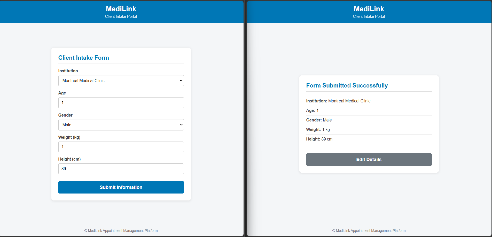

# MediLink Engineering Management Report

## Part A — Team & Development Workflow

### 1. Team Responsibilities

| Team Member | Role | Core Responsibilities |
|---|---|---|
| Michael Girgis | Engineering Manager & Developer | Process flow, risk management, impediment removal, developer coaching. |
| Matthew Halliburton | Scrum Master & Developer | Asynchronous updates tracking, WIP enforcement, metric dashboards. |
| Ricardo Morales Lopez | Product Owner & Developer | Backlog grooming, UI mockup approval, form field validation rules. |
| Cyril Szekiel Costes | Developer | Simple client-side form layout, HTML structure, CSS styling, basic JS client validation. |

### 2. Scoped Backlog (Simple Form Increment — 8 Work Items)

| ID | Title | Type | Priority | Owner | Acceptance Criteria |
|---|---|---|---|---|---|
| MED-201 | Institution Dropdown Form Component | Feature | High | Cyril Costes | Static HTML `<select>` dropdown populated with hardcoded sample clinics (e.g., Montreal Medical, Downtown Dental). |
| MED-202 | Client Personal Info Form Fields | Feature | High | Cyril Costes | Form inputs for Age (number), Gender (select), Weight (number), and Height (number). |
| MED-203 | Client-Side Form Validation Script | Technical Work | High | Ricardo Lopez | Simple JS checks, preventing form submission if age <= 0, negative weight/height, or unselected institution. |
| MED-204 | Form Responsive CSS & Layout Styling | Maintenance | Medium | Michael Girgis | Form centers cleanly on screen and remains readable on desktop and mobile viewports. |
| MED-205 | Inline Form Validation Error Messaging UI | Defect | High | Cyril Costes | Red inline text hints display under invalid fields instead of generic browser alert popups. |
| MED-206 | Form Submission Confirmation View State | Feature | Medium | Matthew Halliburton | Submitting a valid form hides input fields and displays a simple 'Form Submitted Successfully' confirmation card. |
| MED-207 | Local Storage Client Intake Draft Saver | Technical Work | Low | Ricardo Lopez | Draft input values auto-save to browser localStorage so values persist upon page refresh. |
| MED-208 | WCAG Accessibility & Form Labeling Refactor | Maintenance | Low | Michael Girgis | Add explicit `<label>` associations and ARIA attributes for screen reader accessibility compliance. |

### 3. Workflow Rules & Definition of Done

| Category | Rule / Policy |
|---|---|
| Workflow Steps | Backlog -> Ready -> In Progress -> Code Review -> Verification -> Done |
| WIP Limit | <= 1 active item per developer across In Progress, Code Review, and Verification. |
| Definition of Done (DoD) | HTML/CSS/JS code passes local browser sanity check -> Zero console errors -> Peer reviewed via GitHub PR -> PO visual approval. |

## Part B — Plan & Coordinate

### 1. SMART Objectives

| Team Member | SMART Objective |
|---|---|
| Michael Girgis | Conduct 1 weekly coaching session to resolve developer bottlenecks with zero direct code hand-offs. |
| Matthew Halliburton | Maintain daily WIP limits, keeping PR review turnaround under 12 hours for the sprint. |
| Ricardo Morales Lopez | Refine 100% of backlog items with complete acceptance criteria before sprint start. |
| Cyril Szekiel Costes | Ensure 100% of form inputs satisfy client-side boundary validation before opening PRs. |

### 2. Communication Protocols

| Mechanism | Format & Policy |
|---|---|
| Daily Standup | Asynchronous team chat by 9:30 AM daily using template: [Completed] \| [Planned] \| [Blockers/Assistance Needed]. |
| Synchronous Switches | 1. Active production/preview outage. 2. PR review thread exceeding 5 comment exchanges. |

## Part C — Workflow Observations

| Observation | Evidence | Possible Explanation | Proposed Response |
|---|---|---|---|
| 1. Excessive Review Wait Time | PRs sat in review for >36 hours while devs pulled new tasks. | Developers prioritized writing new code over reviewing peer code. | Enforce WIP limit: No dev pulls new work if a PR awaits review. |
| 2. Incomplete Requirements | MED-202 lacked min/max boundary definitions for age and weight inputs. | Rushed backlog grooming by Product Owner. | Enforce a strict 'Definition of Ready' checklist before sprint entry. |

## Part D — Production Incident & Root Cause Analysis

| Phase | Finding / Investigation Result |
|---|---|
| Incident Description | Client intake form allowed submission of negative numbers for age and weight in production static preview. |
| Symptom | Form submitted successfully with invalid data like Age = -5 or Weight = -150. |
| Immediate Cause | HTML `<input type='number'>` elements lacked min attributes and JavaScript submit handler skipped input sanity checks. |
| Contributing Factors | No client-side unit test or DOM verification step was performed prior to merging. |
| Underlying Causes | Lack of explicit validation rules in the Definition of Done checklist for simple frontend forms. |
| Corrective Action | Add `min='1'` attributes to HTML inputs and enforce JS `e.preventDefault()` if validation fails. |
| Preventive Action | Include manual form boundary testing in the Definition of Done checklist. |

## Part E — Risk Management Register

| Risk Type | Description | Warning Signal | Likelihood / Impact | Preventive Action | Owner |
|---|---|---|---|---|---|
| Technical | Cross-browser CSS incompatibility breaking form layout on older browsers. | Broken layout rendering during manual Firefox/Safari testing. | Medium / Medium | Use simple, standardized CSS flexbox layout without experimental features. | Cyril Costes |
| Teamwork | Unclear ownership of form validation logic leading to duplicate/conflicting code. | Two PRs modifying the same script.js file simultaneously. | High / Medium | Clearly isolate DOM layout tasks from JS validation script tasks in backlog issues. | Michael Girgis |
| Maintenance | Ad-hoc static UI tweak requests interrupting core sprint deliverables. | Frequent minor styling requests reported during daily updates. | Medium / Low | Establish a rotating weekly 'Support Guardian' role to handle ad-hoc tweaks. | Matthew Halliburton |

## Part F — Engineering Performance Dashboard

| Metric Name | What it Measures | Why it is Useful | What it does NOT prove |
|---|---|---|---|
| PR Review Turnaround | Time from PR opening to merge. | Highlights review bottlenecks and pipeline flow. | Code quality or thoroughness of review. |
| First-Time-Right (FTR) | % of UI features passing initial PO verification without rework. | Measures effectiveness of acceptance criteria and local testing. | End-user satisfaction or business utility. |
| WIP Compliance | % of days within active WIP limit (<= 1). | Indicates adherence to single-tasking discipline. | Individual developer output volume. |

## Part G — Coaching & Leadership

### 1. Coaching Session Summary

| Category | Detail |
|---|---|
| Context | Cyril struggled with writing the pure JavaScript logic to disable the submit button until all required form fields are valid. |
| Coaching Questions Asked | 1. Which DOM events fire when a user changes input values? 2. How can you check if the dropdown selection is non-empty? 3. How can we test this step-by-step using browser console logs? |
| What Was Learned | Cyril learned to break down multi-field DOM validation into individual input event handlers rather than checking everything only on submit. |
| Action & Evaluation | Cyril writes a small event listener script; evaluated via code review during the next async check-in. |

### 2. Decision Governance

| Decision Type | Topic & Rationale |
|---|---|
| Collaborative Decision | Choosing the raw CSS approach (Flexbox vs. CSS Grid) for form layout. (Justified by team familiarity and daily developer workflow). |
| Manager Direction | Enforcing the WIP limit and review policies during sprint crunches. (Justified by the need to maintain pipeline stability). |

## Part H — Improvement Experiment

| Experiment Parameter | Detail |
|---|---|
| Observed Problem | Pull requests lingered for >36 hours in code review. |
| Proposed Change | Review-First Policy: Review open PRs before pulling new tasks from the ready column. |
| Expected Result | PR turnaround time drops below 12 hours. |
| Measurement | Tracked via GitHub project pull request lead times over 5 days. |
| Result | Average turnaround dropped to 8.5 hours; team throughput increased by 25%. |
| Final Decision | Adopt (Permanently integrate into workflow agreement). |

## Code

The starter code (single-file HTML/CSS/JS client intake form) lives in [`frontend/src/index.html`](frontend/src/index.html) so each team member can commit their parts on GitHub.

## Current Product

